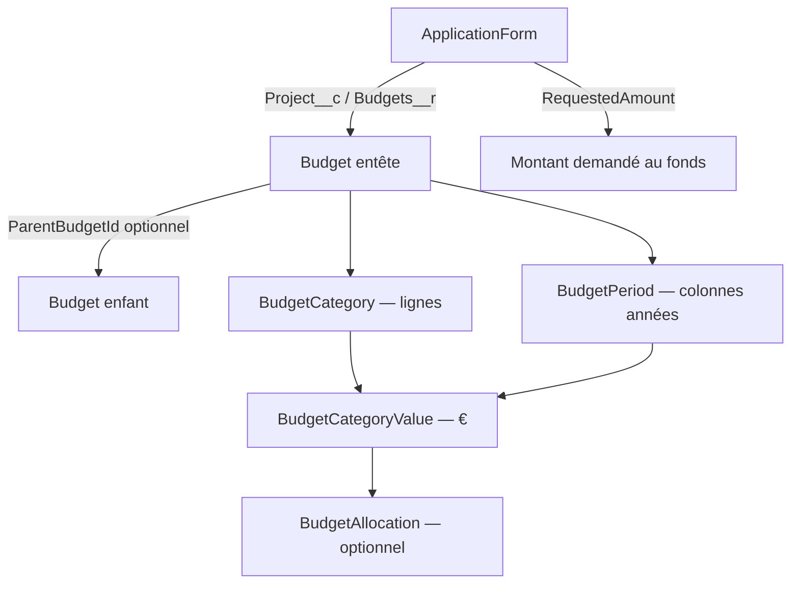
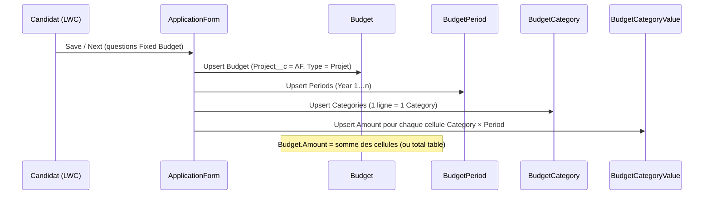

# Budget — Process CRM & Mapping des 3 premières questions

**Domaine :** Salesforce Nonprofit Cloud / Public Sector Solutions — Grantmaking  
**Objets :** `ApplicationForm`, `Budget`, `BudgetPeriod`, `BudgetCategory`, `BudgetCategoryValue`, `BudgetAllocation`  
**Date :** 25 Septembre 2026  
**Périmètre :** les **3 premières questions budget** du common core

| # | Question feuille | Type UI |
|---|------------------|---------|
| 1 | Total project budget per year | Table (Item Name × années) |
| 2 | Budget requested from the AXA Foundation | Table (Cost item × années) |
| 3 | Main public / private financial partners | Table (Names × années + dropdowns) |

---

## 1. Process : d’ApplicationForm vers Budget

### 1.1. Lien Application Form ↔ Budget

```
ApplicationForm (projet / candidature)
  │
  ├─ RequestedAmount          ← montant global demandé au fonds (champ AF)
  ├─ BudgetId                 ← lookup optionnel vers 1 Budget « principal »
  │
  └─ Budgets__r               ← related list (Budget.Project__c → ApplicationForm)
        │
        ├─ Budget « Total project budget »      (Type = Projet)
        ├─ Budget « Requested from AXA »        (Type = Projet)
        └─ Budget « Financial partners »        (Type = Projet)   ← question 3
```

| Côté | Champ / relation | Rôle |
|------|------------------|------|
| ApplicationForm | `RequestedAmount` | Montant demandé au fonds (label CRM : *Budget Requested from the Fund*) |
| ApplicationForm | `BudgetId` | Pointeur vers **un** Budget d’entête (optionnel) |
| Budget | `Project__c` | Lookup vers l’Application Form → alimente la related list **Budgets** (`Budgets__r`) |
| Budget | `ParentBudgetId` | Hiérarchie Budget parent → Budget enfant (related list **Child Budgets** / `ChildBudget`) |
| Budget | `Type` | Picklist : `Service` \| `Programme` \| `Projet` — pour ces 3 questions → **`Projet`** |
| Budget | `Status` | `Planifié` \| `Actif` \| `Archivé` |
| Budget | `Amount` | Total € du budget (somme des cellules / total table) |

**Règle métier retenue :**  
1 question table budget = **1 enregistrement Budget** (entête) lié à l’AP via `Project__c`.  
Les 3 questions = **3 Budgets** distincts sur le même Application Form (visibles dans la related list **Budgets**).

### 1.2. Budget parent vs Budget enfant

```
Budget (parent)                    ex. « Total project budget 2026-2030 »
  │  ParentBudgetId = null
  │
  └─ ChildBudget (Budgets enfants)   via Budget.ParentBudgetId
        │
        └─ Budget (enfant)           ex. découpage optionnel (sous-enveloppe, année isolée…)
```

| Usage | Quand l’utiliser |
|-------|------------------|
| **Parent only** (recommandé pour les 3 questions) | Une entête Budget par table ; le détail année / ligne vit dans Period / Category / Value |
| **Parent + enfants** | Seulement si le métier veut une hiérarchie d’enveloppes (ex. budget global → sous-budgets par lot). **Pas nécessaire** pour mapper les 3 tables du formulaire |

Pour le mapping formulaire actuel : **pas besoin de Budget enfant**. Toute la grille = Period + Category + CategoryValue sous **un** Budget parent.

### 1.3. Related lists sous un Budget (détail de la grille)

Sous chaque Budget (related lists Salesforce) :

```
Budget  (entête)
  │
  ├── BudgetPeriods        (BudgetPeriod)         ← colonnes « Year 1 », « Year 2 »…
  ├── BudgetCategories     (BudgetCategory)       ← lignes « Item Name » / « Cost item » / « Names »
  │      └── BudgetCategoryValues                 ← cellule € (Category × Period)
  └── BudgetAllocations    (BudgetAllocation)     ← allocation liée à une CategoryValue (optionnel)
```

| Related list | Objet | = dans le tableau UI |
|--------------|-------|----------------------|
| **Budget Periods** | `BudgetPeriod` | En-têtes de colonnes (années) |
| **Budget Categories** | `BudgetCategory` | Lignes (items / partenaires) |
| *(via Category)* **Budget Category Values** | `BudgetCategoryValue` | Intersection ligne × colonne (€) |
| **Budget Allocations** | `BudgetAllocation` | Optionnel (décaissement / allocation) — **pas requis** pour saisir la table candidat |
| **Child Budgets** | `Budget` (`ParentBudgetId`) | Hiérarchie — **pas requis** pour les 3 questions |

### 1.4. Concordance cellule UI ↔ records CRM

Exemple (question 1 — Total project budget) :

| Item Name | Year 1 (€ | Year 2 (€ | Year 3 (€ | TOTAL |
|-----------|-----------|-----------|-----------|-------|
| Personnel | 10 000    | 12 000    | 8 000     | 30 000 |
| Travel    | 2 000     | 2 000     | 1 000     | 5 000 |

Ce que ça crée en CRM :

| Record | Valeurs |
|--------|---------|
| 1 × `Budget` | `Name` = Total project budget, `Type` = Projet, `Project__c` = AP, `Amount` = 35 000 |
| 3 × `BudgetPeriod` | Name = Year 1 / Year 2 / Year 3 |
| 2 × `BudgetCategory` | Name = Personnel / Travel |
| 6 × `BudgetCategoryValue` | `Amount` = cellule ; `BudgetCategoryId` + `BudgetDivisionId` (Period) |



### 1.5. Flux candidat → CRM (Fixed questions)



---

## 2. Vue finale — Mapping des 3 questions

### 2.1. Question 1 — Total project budget per year

| Colonne / élément UI | Mapped (CRM) | Objet (Common core) |
|----------------------|--------------|---------------------|
| *(table entière)* | 1 `Budget` : `Name`, `Type` = Projet, `Project__c` = AP, `Amount` = total | **Budget** |
| **Item Name** | `BudgetCategory.Name` | **BudgetCategory** |
| **Year 1 (€)** — libellé | `BudgetPeriod.Name` = `Year 1` | **BudgetPeriod** |
| **Year 1 (€)** — valeur | `BudgetCategoryValue.Amount` | **BudgetCategoryValue** |
| **Year 2 / 3 / Years 4&5** | idem Period + Value | **BudgetPeriod** + **BudgetCategoryValue** |
| **TOTAL** (ligne / colonne) | Calcul UI **ou** `Budget.Amount` | **Budget** |

**1 ligne UI = 1 `BudgetCategory`.**  
**1 année = 1 `BudgetPeriod`.**  
**1 cellule € = 1 `BudgetCategoryValue`.**

---

### 2.2. Question 2 — Budget requested from the AXA Foundation

Même modèle que la question 1, **autre Budget** (même AP) :

| Colonne / élément UI | Mapped (CRM) | Objet (Common core) |
|----------------------|--------------|---------------------|
| *(table entière)* | 1 `Budget` distinct : `Name` = Requested from AXA (ou équivalent), `Type` = Projet, `Project__c` = AP | **Budget** |
| **Cost item** | `BudgetCategory.Name` | **BudgetCategory** |
| **Year N (€)** — libellé | `BudgetPeriod.Name` | **BudgetPeriod** |
| **Year N (€)** — valeur | `BudgetCategoryValue.Amount` | **BudgetCategoryValue** |
| **TOTAL** | `Budget.Amount` | **Budget** |

**Lien avec le champ AF :**  
`ApplicationForm.RequestedAmount` (*Budget Requested from the Fund*) peut reprendre le **total** de ce Budget (alignement métier à confirmer : = `Budget.Amount` du budget « Requested », ou saisie séparée).

| Champ AF | Usage suggéré |
|----------|----------------|
| `RequestedAmount` | Total demandé à AXA (= total table Q2) |
| `BudgetId` | Pointer vers le Budget « Requested » **ou** le Budget principal — à trancher côté métier |

---

### 2.3. Question 3 — Main public / private financial partners

Même squelette Period / Category / Value, avec **2 customs à créer** sur `BudgetCategory` (absents en standard) :

| Colonne UI | Mapped (CRM) | Objet |
|------------|--------------|-------|
| *(table entière)* | 1 `Budget` : `Name` = Financial partners, `Type` = Projet, `Project__c` = AP | **Budget** |
| **Names** | `BudgetCategory.Name` | **BudgetCategory** |
| **Secured or planned** | `BudgetCategory.FundingStatus__c` *(picklist à créer : Secured / Planned)* | **BudgetCategory** |
| **Public or private** | `BudgetCategory.FundingSourceType__c` *(picklist à créer : Public / Private)* | **BudgetCategory** |
| **Year 1 / 2 / 3 (€)** | `BudgetPeriod.Name` + `BudgetCategoryValue.Amount` | **BudgetPeriod** + **BudgetCategoryValue** |
| **Amount (€)** | Somme des Values de la ligne *(ou roll-up)* | **BudgetCategoryValue** |
| **%** | Calcul UI *(ou formula `SharePercent__c`)* | — / **BudgetCategory** |

Sans les 2 customs, les dropdowns ne peuvent pas vivre proprement en CRM.

---

## 3. Synthèse visuelle — 3 Budgets sur 1 Application Form

```
ApplicationForm
│
├─ RequestedAmount ......................... total demandé (souvent = Q2)
│
└─ Budgets__r
   │
   ├─ [Q1] Budget « Total project budget »
   │     ├─ Periods: Year 1, Year 2, …
   │     ├─ Categories: Personnel, Travel, …
   │     └─ CategoryValues: € par cellule
   │
   ├─ [Q2] Budget « Requested from AXA »
   │     ├─ Periods: Year 1, Year 2, …
   │     ├─ Categories: Cost items…
   │     └─ CategoryValues: € par cellule
   │
   └─ [Q3] Budget « Financial partners »
         ├─ Periods: Year 1, Year 2, Year 3
         ├─ Categories: partenaires (+ FundingStatus__c, FundingSourceType__c)
         └─ CategoryValues: € par cellule
```

### Récap mapping feuille

| # | Question | Mapped (CRM) principal | Common core |
|---|----------|------------------------|-------------|
| 1 | Total project budget per year | `Budget` + `BudgetCategory` + `BudgetPeriod` + `BudgetCategoryValue` | Budget* |
| 2 | Budget requested from AXA | idem (+ `ApplicationForm.RequestedAmount` pour le total) | Budget* / ApplicationForm |
| 3 | Financial partners | idem + customs `FundingStatus__c` / `FundingSourceType__c` | Budget* |

### Ce qu’on n’utilise **pas** pour ces 3 questions

| Élément | Pourquoi |
|---------|----------|
| Budget enfant (`ParentBudgetId`) | Grille couverte par Period / Category / Value |
| `BudgetAllocation` | Pas nécessaire à la saisie candidat (plutôt post-attribution / décaissement) |
| Dynamic / `AssessmentQuestionResponse` JSON | Réservé si on **ne** mappe **pas** en CRM ; ici les 3 questions sont **Mapped (CRM)** |

---

## 4. Points d’attention

1. **3 Budgets ≠ 1 Budget** — ne pas tout fusionner dans un seul record ; la related list **Budgets** sur l’AP doit montrer les 3 entêtes.
2. **Period partagée par Budget** — chaque Budget a ses propres `BudgetPeriod` (même si les libellés d’années sont identiques).
3. **Q3 customs obligatoires** — sans `FundingStatus__c` / `FundingSourceType__c`, les 2 dropdowns restent hors CRM.
4. **`RequestedAmount` vs Q2** — aligner le total table « Requested » avec le champ AF pour éviter double saisie contradictoire.
5. **Upsert Fixed** — Object/Field API Name sur les questions Fixed doivent cibler la chaîne Budget (logique multi-record table à implémenter côté player, pas un simple champ scalaire).
