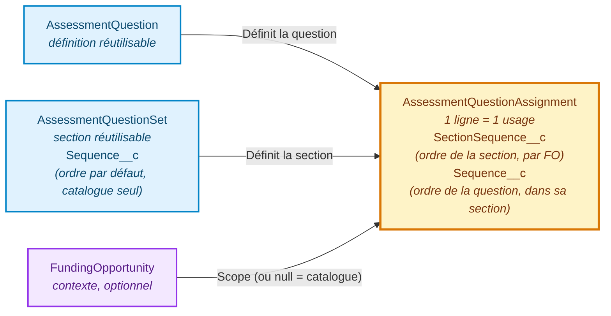

# Séquençage des Questions & Types de Question (Fixed / Dynamic)

**Domaine :** Salesforce Nonprofit Cloud — Grantmaking & Discovery Framework
**Objets concernés :** `AssessmentQuestion`, `AssessmentQuestionSet`, `AssessmentQuestionAssignment`
**Date :** 17 Septembre 2026

---

## 1. Pourquoi l'ordre (Sequence) vit sur l'Assignment, pas sur la Question

### 1.1. Le problème de la réutilisation

Une `AssessmentQuestion` (ou un `AssessmentQuestionSet`) n'est **pas propre à un seul usage** — c'est une définition réutilisable :

- Une question du catalogue partagé peut être ajoutée à **plusieurs sections différentes**.
- Elle peut être rattachée à **plusieurs Funding Opportunities** différentes en même temps (via "Add Selected to Funding Opportunity").

Si l'ordre (`Sequence`) était stocké **directement sur `AssessmentQuestion`**, la question n'aurait qu'**une seule position possible**, partagée par tous ses usages. Impossible alors qu'elle soit 3ème dans une section et 1ère dans une autre, ou 2ème pour la FO A et 5ème pour la FO B.

### 1.2. La solution : la table de jonction

`AssessmentQuestionAssignment` est la table de jonction entre :
- `AssessmentQuestion` (la définition, unique, réutilisable)
- `AssessmentQuestionSet` (la section, elle aussi réutilisable)
- `FundingOpportunity` (le contexte, optionnel — `null` pour le catalogue partagé)

Chaque **usage** d'une question a sa **propre ligne** d'assignment, donc son **propre ordre** — indépendant à chaque endroit où la question apparaît, sans jamais toucher à la question elle-même ni impacter ses autres usages.

### 1.3. Les 3 champs de séquence, et où ils vivent

| Champ | Objet porteur | Rôle |
|---|---|---|
| `Sequence__c` | `AssessmentQuestionSet` | Ordre **par défaut** des sections dans le **catalogue partagé** uniquement (vue "Shared Catalog", sans FO). Mis à jour par `reorderSections()` lors d'un drag & drop dans cette vue. |
| `SectionSequence__c` | `AssessmentQuestionAssignment` | Ordre de **la section** au sein d'**une Funding Opportunity précise**. Rempli uniquement en vue FO (`null` en vue catalogue partagé). Permet à chaque FO d'avoir son propre ordre de sections, sans affecter les autres FO ni le catalogue. |
| `Sequence__c` | `AssessmentQuestionAssignment` | Ordre de **la question** à l'intérieur de sa section. Rempli dans les deux vues (catalogue partagé ET par FO). |

### 1.4. Tri effectif

```sql
-- Vue Funding Opportunity
ORDER BY SectionSequence__c ASC NULLS LAST, Sequence__c ASC NULLS LAST

-- Vue Catalogue partagé
ORDER BY Sequence__c ASC NULLS LAST  -- (celui de AssessmentQuestionSet, pour les sections)
```

Pour une question donnée en vue FO, les deux champs de l'Assignment travaillent ensemble : `SectionSequence__c` place sa section, `Sequence__c` la place à l'intérieur de cette section.

### 1.5. Schéma récapitulatif



---

## 2. Proposition : Type de Question Fixed vs Dynamic

### 2.1. Besoin

Actuellement, **toute** réponse à une question passe par le mécanisme "Dynamic" : elle est stockée dans `Assessment` / `AssessmentQuestionResponse` (voir `AP02_ApplicationFormPlayerController.saveSectionResponses`), quel que soit le `DataType`.

Le besoin exprimé est de distinguer deux modes de stockage pour une question, au niveau de sa configuration dans le catalogue :

| Type | Stockage de la réponse | Cas d'usage |
|---|---|---|
| **Dynamic** (comportement actuel) | `Assessment` / `AssessmentQuestionResponse` — un enregistrement générique de réponse, non lié à un champ CRM précis. | Questions ad-hoc, propres au processus de candidature, sans existence en dehors de l'Assessment. |
| **Fixed** (nouveau) | Directement sur un **champ d'un objet CRM standard** (ex: `Account.Phone`, `Contact.Email`, ou tout autre champ métier) — à configurer via **Object API Name** + **Field API Name**. | Questions qui correspondent en réalité à un champ CRM déjà existant (ex: "Quel est le SIRET de votre structure ?" → écrit directement sur `Account.SIRET__c`), pour éviter la duplication de la donnée entre l'Assessment et le CRM. |

### 2.2. Modélisation retenue : la distinction Fixed/Dynamic reste au niveau `AssessmentQuestion`, Shared/Local reste au niveau `AssessmentQuestionSet`

Un enregistrement Salesforce ne peut avoir qu'**un seul** Record Type à la fois — `Shared`/`Local` et `Fixed`/`Dynamic` ne peuvent donc pas coexister comme deux Record Types indépendants sur le **même** objet sans les combiner (`Shared-Fixed`, `Shared-Dynamic`, etc.).

**Décision** : on répartit les deux distinctions sur deux objets différents, qui portent chacun une seule dimension :

| Objet | Record Types | Rôle |
|---|---|---|
| `AssessmentQuestionSet` (la section) | `Shared` / `Local` — **inchangé** | Portée : catalogue partagé vs section propre à une FO. |
| `AssessmentQuestion` (la question) | `Fixed` / `Dynamic` — **nouveau, remplace l'usage actuel** | Mode de stockage de la réponse (voir 2.1). |

Ceci est rendu possible par un constat clé, vérifié dans le code existant : le Record Type `Local`/`Shared` sur `AssessmentQuestion` n'est **lu par aucune requête** aujourd'hui — seul celui de `AssessmentQuestionSet` (la section) est effectivement exploité pour filtrer/scoper (`AP01_CatalogQueryService`). La portée locale/partagée d'une question est de toute façon dictée par la section (elle-même Local/Shared) à laquelle elle est assignée. Le Record Type sur `AssessmentQuestion` est donc libre d'être réutilisé pour porter `Fixed`/`Dynamic` à la place, sans rien casser.

**Résultat** : pas de combinatoire, pas de conflit avec l'existant — `Shared`/`Local` continue de fonctionner exactement comme aujourd'hui sur les sections, et `Fixed`/`Dynamic` devient la seule question posée par le Record Type d'une `AssessmentQuestion`.

### 2.3. Champs à ajouter sur `AssessmentQuestion` (Record Type `Fixed` uniquement)

| Champ (à créer) | Type | Rôle |
|---|---|---|
| `FixedObjectApiName__c` | Text | Nom API de l'objet CRM cible (ex: `Account`, `Contact`). *Valeur à renseigner plus tard, par question.* |
| `FixedFieldApiName__c` | Text | Nom API du champ cible sur cet objet (ex: `SIRET__c`). *Valeur à renseigner plus tard, par question.* |

*(Alternative plus robuste à évaluer : un couple de champs Lookup vers `EntityDefinition`/`FieldDefinition` pour valider dynamiquement que le champ existe réellement, plutôt que du texte libre — à arbitrer selon le niveau de contrôle souhaité par l'équipe.)*

### 2.4. Contrainte à respecter : la séquence

Que la question soit `Fixed` ou `Dynamic`, elle reste rattachée à une section via `AssessmentQuestionAssignment` de la même façon — **le mécanisme de séquence décrit en Section 1 ne change pas**. Une question `Fixed` doit donc :
- Toujours passer par une ligne `AssessmentQuestionAssignment` (section + éventuellement FO).
- Respecter `SectionSequence__c` / `Sequence__c` comme n'importe quelle autre question, pour son affichage dans le player.

Seul le **mécanisme d'enregistrement de la réponse** change (écriture sur le champ CRM au lieu de `AssessmentQuestionResponse`) — la configuration, l'ordre et l'affichage restent gérés exactement comme aujourd'hui.

### 2.5. Impact attendu sur le code existant (à confirmer avant développement)

- **`AP01_SchemaUtils.getRecordTypeId(AssessmentQuestion.sObjectType, ...)`** : actuellement appelé avec `isLocal ? 'Local' : 'Shared'` dans `createQuestion`/`updateQuestion`. À remplacer par `isFixed ? 'Fixed' : 'Dynamic'` (nouveau paramètre venant du modal) — sans impact sur le comportement actuel, puisque ce Record Type n'était lu par aucune requête existante.
- **`lwc01CatalogBuilder`** : le modal Add/Edit Question devrait proposer le choix Fixed/Dynamic, et afficher les champs Object API Name / Field API Name uniquement pour `Fixed`.
- **`AP02_ApplicationFormPlayerController.saveSectionResponses`** : pour une question `Fixed`, écrire sur le champ CRM configuré au lieu de créer/mettre à jour un `AssessmentQuestionResponse` — nécessite de connaître l'enregistrement CRM cible (ex: l'`Account` lié au candidat) au moment de la sauvegarde.
- **`getFormDefinition`** : pour une question `Fixed`, précharger la valeur existante depuis le champ CRM lui-même plutôt que depuis `AssessmentQuestionResponse`.

*Ces points sont volontairement listés comme pistes de travail, pas comme un engagement d'implémentation — à confirmer une fois le choix de modélisation (Section 2.2) tranché.*
