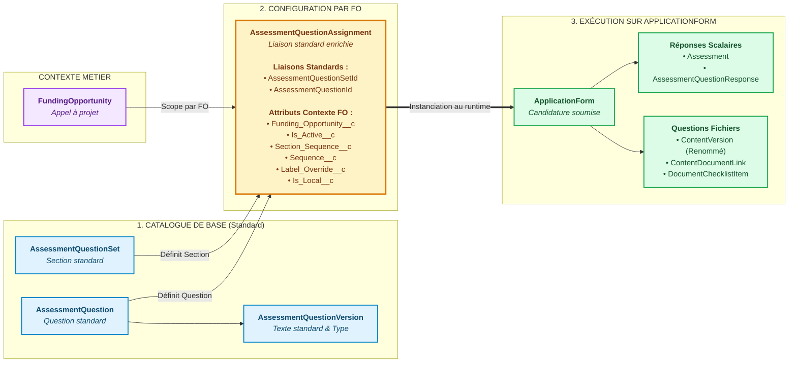
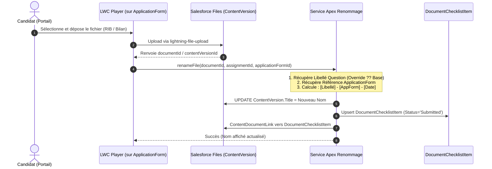

# Solution Technique : Configuration Dynamique des Questions par Funding Opportunity
**Domaine :** Salesforce Nonprofit Cloud — Grantmaking & Discovery Framework  
**Objet Candidature :** `ApplicationForm`  
**Date :** 11 Septembre 2026  
**Auteur :** Lead Solution Architect Salesforce Grantmaking  

---

## 1. Contexte et Objectifs Métier

Le besoin consiste à permettre aux gestionnaires de subventions (Grantmakers) de configurer dynamiquement le formulaire de candidature pour chaque **Funding Opportunity (FO)** à partir d'un catalogue partagé de sections et questions standard, tout en répondant aux exigences suivantes :

1. **Catalogue de base réutilisable :** Définir une banque centrale de sections (steps) et questions partagées entre toutes les opportunités.
2. **Sélection par Checkboxes :** Sur chaque FO, choisir simplement les questions à activer ou désactiver.
3. **Ordonnancement Drag & Drop :** Réordonner librement la séquence des sections et des questions au sein de chaque section pour une FO donnée.
4. **Indépendance stricte des FO :**
   - Modifier l'ordre ou le libellé d'une question sur la **FO A** n'impacte **jamais** la **FO B** ni la question du catalogue central.
   - Pas de duplication/clonage massif des questions de base (seules les assignations sont instanciées).
5. **Personnalisation locale vs globale :**
   - Possibilité de surcharger un libellé uniquement pour la FO en cours, OU de mettre à jour le catalogue central.
   - Possibilité d'ajouter une question/section locale à une FO (sans polluer le catalogue), OU de l'ajouter au catalogue partagé.
6. **Support du type "Fichier" (Upload) :**
   - Question invitant le candidat à téléverser un document.
   - Renommage automatique du fichier selon le format imposé par le métier : `[Libellé Question] - [ApplicationForm Ref] - [Date]`.
   - Rapprochement avec le standard Grantmaking : `DocumentChecklistItem` (DCI) et `ContentVersion` rattachés à `ApplicationForm`.
7. **Exécution Candidat :** Rendu dynamique dans un OmniScript de candidature hébergé sur le portail Experience Cloud, stockant les réponses sur `ApplicationForm`.

---

## 2. Architecture des Données (Standard-First)

Pour garantir la pérennité de l'application et éviter toute dette technique, la solution **abandonne les objets custom isolés** (tels que `Assessment_Step__c`) et s'appuie à 100% sur le socle **Discovery Framework** et **Grantmaking**, enrichi de quelques champs de contexte légers.

### 2.1. Les 3 Niveaux de Données



---

### 2.2. Dictionnaire des Objets

#### A. Niveau 1 : Catalogue de Base & Sections Locales
* **`AssessmentQuestionSet`** : Représente une **Section** (ex: *"1. Structure juridique"*, *"2. Budget prévisionnel"*).
  * **Section Partagée (Catalogue)** : `Funding_Opportunity__c = null`. Réutilisable par toutes les FO.
  * **Section Locale (Propre à la FO)** : `Funding_Opportunity__c = recordId` et `Is_Local__c = true`. Visible et utilisable **uniquement** sur cette FO. Elle peut accueillir aussi bien des questions du catalogue que des questions locales.
* **`AssessmentQuestion` & `AssessmentQuestionVersion`** : Questions atomiques réutilisables. Le champ `DataType` standard gère `Text`, `Number`, `Date`, `Radio`, etc.  
  *Pour les documents :* la valeur `File` est supportée pour identifier une question appelant un dépôt de document.
* **`DocumentType`** *(Optionnel standard)* : Référentiel des types officiels de pièces justificatives (ex: *"RIB"*, *"Statuts"*).

#### B. Niveau 2 : Table d'Assignation et de Configuration par FO
Au lieu d'un objet custom complexe, nous utilisons l'objet standard de jonction **`AssessmentQuestionAssignment`**, étendu avec les champs de contexte suivants :

| Champ API | Type | Rôle Métier |
|---|---|---|
| `AssessmentQuestionSetId` | Lookup(AssessmentQuestionSet) | **Standard** — La section d'appartenance. |
| `AssessmentQuestionId` | Lookup(AssessmentQuestion) | **Standard** — La question de catalogue associée. |
| `Funding_Opportunity__c` | Lookup(FundingOpportunity) | **Extension** — La Funding Opportunity spécifique (scoping). Si `null`, représente l'assignation du template de base. |
| `Is_Active__c` | Checkbox | `true` = cochée et visible pour cette FO. `false` = décochée. |
| `Section_Sequence__c` | Number(3,0) | Ordre de la section dans la page (piloté par Drag & Drop). |
| `Sequence__c` | Number(3,0) | Ordre de la question au sein de sa section (Drag & Drop). |
| `Label_Override__c` | Text(255) / LongTextArea | Surcharge du libellé pour cette FO. Si vide, utilise le libellé standard de la question. |
| `Is_Local__c` | Checkbox | `true` si la question a été créée uniquement pour cette FO. |

#### C. Niveau 3 : Exécution & Candidature (`ApplicationForm`)
* **`ApplicationForm`** : Dossier de candidature initié par le candidat (Grantseeker). Rattaché à la `FundingOpportunity` via le champ standard `ReferenceRecordId` ou lookup équivalent.
* **`Assessment`** : Instance d'évaluation rattachée à l'`ApplicationForm` (`ResponseContextId = ApplicationForm.Id`).
* **`AssessmentQuestionResponse`** : Stocke les réponses scalaires (texte, nombres, dates, choix).
* **`ContentVersion` & `ContentDocumentLink`** : Stocke physiquement le fichier uploadé et le lie à l'`ApplicationForm`.
* **`DocumentChecklistItem` (DCI)** : Ligne de suivi de la pièce justificative attachée à l'`ApplicationForm` pour l'instructeur.

---

## 3. Cinématique Fonctionnelle & Logique Métier

### 3.1. Gestionnaire : Configuration sur la Funding Opportunity

Sur la fiche Lightning de la `FundingOpportunity`, un composant LWC **"FO Questionnaire Builder"** fournit l'interface visuelle :

1. **Arborescence interactive :**
   - L'écran liste les sections (`AssessmentQuestionSet`) et leurs questions respectives.
   - Les questions actives ont leur checkbox cochée.
2. **Activation / Désactivation (Checkbox) :**
   - Cocher/décocher bascule le flag `Is_Active__c` sur la ligne `AssessmentQuestionAssignment` de cette FO.
   - **Règle d'intégrité :** Aucune suppression physique (`DELETE`). Si des candidatures ont déjà été soumises sur cette FO, l'historique reste préservé.
3. **Ordonnancement Drag & Drop :**
   - Déplacement d'une section entière $\rightarrow$ mise à jour bulk de `Section_Sequence__c`.
   - Déplacement d'une question dans une section $\rightarrow$ mise à jour de `Sequence__c`.
4. **Surcharge de Libellé (Isolation des FO) :**
   - En éditant une question sur la FO A, l'utilisateur a le choix :
     * **"Modifier pour cette opportunité uniquement"** : alimente `Label_Override__c` sur `AssessmentQuestionAssignment`. La question de base et les autres FO restent intactes.
     * **"Modifier dans le catalogue partagé"** : met à jour `AssessmentQuestionVersion.QuestionText`, impactant le template central et les FO qui n'ont pas d'override.
5. **Création d'une Section Propre à la FO (Section Locale) :**
   - L'utilisateur clique sur **"Ajouter une Section"** :
     * **Option "Section partagée (Catalogue central)"** : Crée un `AssessmentQuestionSet` avec `Funding_Opportunity__c = null`. Elle devient immédiatement disponible pour tous les programmes de subventions.
     * **Option "Section propre à cette opportunité (Locale)"** : Crée un `AssessmentQuestionSet` avec `Funding_Opportunity__c = currentFO.Id` et `Is_Local__c = true`.
   - **Association des questions à cette section locale :**
     * Dès que la section locale est créée sur la FO, le gestionnaire peut lui associer :
       1. **Des questions existantes du catalogue partagé** (en les cochant dans la liste des questions disponibles). Une assignation `AssessmentQuestionAssignment` est créée, liant la section locale à la question partagée.
       2. **Des questions créées localement** pour cette opportunité (`Is_Local__c = true`).
6. **Création d'une Question (Locale vs Partagée) :**
   - **Si "Locale à cette FO"** : enregistrement `AssessmentQuestion` créé avec `Funding_Opportunity__c = currentFO.Id` et `Is_Local__c = true`.
   - **Si "Partagée au Catalogue"** : création dans le catalogue central, utilisable par toutes les FO.
7. **Clonage de Configuration entre Funding Opportunities :**
   - Pour dupliquer la configuration de la FO 2024 vers la FO 2025, un bouton **"Cloner la configuration"** duplique uniquement les lignes `AssessmentQuestionAssignment` (et réplique les sections locales si existantes) en adaptant l'Id de la FO cible. **Les questions de base ne sont jamais dupliquées.**

---

### 3.2. Traitement Spécifique des Questions de Type "Fichier" (File)

#### Pourquoi ce mécanisme ?
`AssessmentQuestionResponse` ne stocke aucun fichier binaire. Tout document doit être un `ContentVersion` lié à l'`ApplicationForm`. De plus, le métier exige un renommage strict.

#### Déroulement de l'Upload et du Renommage :



#### Règle de Résolution du Nom de Fichier :
$$\text{Nom du fichier} = \text{Sanitize}(\text{Libellé de la question}) + \text{" - "} + \text{ApplicationForm.Name} + \text{" - "} + \text{FormatDate}(\text{YYYYMMDD})$$

*Exemple :*  
Si la question est *"Attestation bancaire RIB"*, l'`ApplicationForm` est *"APP-2026-0042"*, et la date est le 11/09/2026 :  
👉 **`Attestation bancaire RIB - APP-2026-0042 - 20260911.pdf`**

---

### 3.3. Restitution Candidat sur le Portail (`ApplicationForm`)

1. **Intégration OmniScript :**
   - L'OmniScript de candidature crée ou récupère l'enregistrement `ApplicationForm` rattaché à la `FundingOpportunity`.
   - Dans l'étape du formulaire de subvention, un composant Custom LWC (`assessmentWizard` / `dynamicAssessmentPlayer`) est inséré.
2. **Résolution Dynamique au Runtime :**
   Le LWC appelle la méthode Apex `getFormDefinition(applicationFormId)` qui :
   - Détermine la `FundingOpportunity` rattachée à l'`ApplicationForm`.
   - Récupère toutes les `AssessmentQuestionAssignment` où `Funding_Opportunity__c = :foId AND Is_Active__c = true`.
   - Trie par `Section_Sequence__c ASC, Sequence__c ASC`.
   - Calcule pour chaque question :
     ```java
     String label = String.isNotBlank(assignment.Label_Override__c) 
         ? assignment.Label_Override__c 
         : assignment.AssessmentQuestion.ActiveVersion.QuestionText;
     ```
   - Charge les réponses existantes (`AssessmentQuestionResponse` et `ContentDocumentLink`) si la candidature est reprise en cours de route.
3. **Composants d'affichage dans le formulaire :**
   - `DataType == 'Text'` $\rightarrow$ `lightning-input type="text"`
   - `DataType == 'Date'` $\rightarrow$ `lightning-input type="date"`
   - `DataType == 'Radio' | 'Select'` $\rightarrow$ `lightning-combobox` / `lightning-radio-group`
   - `DataType == 'File'` $\rightarrow$ `lightning-file-upload` branché sur le service de renommage.

---

## 4. Spécifications Techniques d'Implémentation

### 4.1. Enrichissement de `AssessmentQuestionAssignment`

Ajouter les champs personnalisés suivants sur l'objet standard `AssessmentQuestionAssignment` :

```xml
<!-- force-app/main/default/objects/AssessmentQuestionAssignment/fields/Funding_Opportunity__c.field-meta.xml -->
<CustomField xmlns="http://soap.sforce.com/2006/04/metadata">
    <fullName>Funding_Opportunity__c</fullName>
    <label>Funding Opportunity</label>
    <type>Lookup</type>
    <referenceTo>FundingOpportunity</referenceTo>
    <relationshipName>AssessmentQuestionAssignments</relationshipName>
    <required>false</required>
</CustomField>

<!-- Is_Active__c -->
<CustomField xmlns="http://soap.sforce.com/2006/04/metadata">
    <fullName>Is_Active__c</fullName>
    <label>Is Active</label>
    <type>Checkbox</type>
    <defaultValue>true</defaultValue>
</CustomField>

<!-- Section_Sequence__c -->
<CustomField xmlns="http://soap.sforce.com/2006/04/metadata">
    <fullName>Section_Sequence__c</fullName>
    <label>Section Sequence</label>
    <type>Number</type>
    <precision>3</precision>
    <scale>0</scale>
</CustomField>

<!-- Sequence__c -->
<CustomField xmlns="http://soap.sforce.com/2006/04/metadata">
    <fullName>Sequence__c</fullName>
    <label>Sequence</label>
    <type>Number</type>
    <precision>3</precision>
    <scale>0</scale>
</CustomField>

<!-- Label_Override__c -->
<CustomField xmlns="http://soap.sforce.com/2006/04/metadata">
    <fullName>Label_Override__c</fullName>
    <label>Label Override</label>
    <type>Text</type>
    <length>255</length>
</CustomField>

<!-- Is_Local__c -->
<CustomField xmlns="http://soap.sforce.com/2006/04/metadata">
    <fullName>Is_Local__c</fullName>
    <label>Is Local to FO</label>
    <type>Checkbox</type>
    <defaultValue>false</defaultValue>
</CustomField>
```

#### Champs pour les Sections Locales (`AssessmentQuestionSet`) :
Ajouter les champs suivants sur `AssessmentQuestionSet` pour permettre la création de sections propres à une FO :

```xml
<!-- force-app/main/default/objects/AssessmentQuestionSet/fields/Funding_Opportunity__c.field-meta.xml -->
<CustomField xmlns="http://soap.sforce.com/2006/04/metadata">
    <fullName>Funding_Opportunity__c</fullName>
    <label>Funding Opportunity</label>
    <type>Lookup</type>
    <referenceTo>FundingOpportunity</referenceTo>
    <relationshipName>AssessmentQuestionSets</relationshipName>
    <required>false</required>
    <description>Renseigné uniquement si la section est créée pour cette FO spécifique (section locale). Null si section de catalogue partagé.</description>
</CustomField>

<!-- force-app/main/default/objects/AssessmentQuestionSet/fields/Is_Local__c.field-meta.xml -->
<CustomField xmlns="http://soap.sforce.com/2006/04/metadata">
    <fullName>Is_Local__c</fullName>
    <label>Is Local to FO</label>
    <type>Checkbox</type>
    <defaultValue>false</defaultValue>
</CustomField>
```

---

### 4.2. Service Apex : Renommage et Liaison Documentaire

```apex
public with sharing class DocumentManagementService {

    public class RenameResult {
        @AuraEnabled public Boolean isSuccess;
        @AuraEnabled public String updatedTitle;
        @AuraEnabled public String errorMessage;
    }

    @AuraEnabled
    public static RenameResult renameAndLinkDocument(Id contentDocumentId, Id assignmentId, Id applicationFormId) {
        RenameResult result = new RenameResult();
        try {
            // 1. Informations de l'assignation et libellé de la question
            AssessmentQuestionAssignment aqa = [
                SELECT Label_Override__c, AssessmentQuestion.ActiveVersion.QuestionText, AssessmentQuestion.QuestionCategory
                FROM AssessmentQuestionAssignment
                WHERE Id = :assignmentId
                LIMIT 1
            ];

            String effectiveLabel = String.isNotBlank(aqa.Label_Override__c)
                ? aqa.Label_Override__c
                : aqa.AssessmentQuestion.ActiveVersion.QuestionText;

            // 2. Informations du dossier ApplicationForm
            ApplicationForm appForm = [
                SELECT Id, Title, Name
                FROM ApplicationForm
                WHERE Id = :applicationFormId
                LIMIT 1
            ];
            String appRef = String.isNotBlank(appForm.Name) ? appForm.Name : 'CANDIDATURE';

            // 3. Récupération de la version du fichier
            ContentVersion cv = [
                SELECT Id, Title, FileExtension
                FROM ContentVersion
                WHERE ContentDocumentId = :contentDocumentId AND IsLatest = true
                LIMIT 1
            ];

            // 4. Calcul du titre normalisé : "Libellé - Référence - Date"
            String sanitizedLabel = effectiveLabel.replaceAll('[\\\\/:*?"<>|]', '_').trim();
            String dateStamp = Datetime.now().format('yyyyMMdd');
            String newTitle = (sanitizedLabel + ' - ' + appRef + ' - ' + dateStamp).left(255);

            cv.Title = newTitle;
            update cv;

            // 5. Création / Mise à jour du DocumentChecklistItem standard
            upsertDocumentChecklistItem(applicationFormId, contentDocumentId, effectiveLabel);

            result.isSuccess = true;
            result.updatedTitle = newTitle;
        } catch (Exception ex) {
            result.isSuccess = false;
            result.errorMessage = ex.getMessage();
        }
        return result;
    }

    private static void upsertDocumentChecklistItem(Id applicationFormId, Id contentDocumentId, String itemTitle) {
        List<DocumentChecklistItem> existingItems = [
            SELECT Id, Status 
            FROM DocumentChecklistItem 
            WHERE ParentRecordId = :applicationFormId AND Name = :itemTitle 
            LIMIT 1
        ];

        DocumentChecklistItem dci;
        if (!existingItems.isEmpty()) {
            dci = existingItems[0];
            dci.Status = 'Submitted';
            update dci;
        } else {
            dci = new DocumentChecklistItem(
                ParentRecordId = applicationFormId,
                Name = itemTitle.left(255),
                Status = 'Submitted'
            );
            insert dci;
        }

        // Lier le document au DCI
        List<ContentDocumentLink> existingLinks = [
            SELECT Id 
            FROM ContentDocumentLink 
            WHERE LinkedEntityId = :dci.Id AND ContentDocumentId = :contentDocumentId
        ];
        if (existingLinks.isEmpty()) {
            insert new ContentDocumentLink(
                LinkedEntityId = dci.Id,
                ContentDocumentId = contentDocumentId,
                ShareType = 'V',
                Visibility = 'AllUsers'
            );
        }
    }
}
```

---

### 4.3. Contrôleur Apex : Résolution Formulaire pour `ApplicationForm`

```apex
public with sharing class AssessmentFormPlayerController {

    public class StepModel {
        @AuraEnabled public Id sectionId;
        @AuraEnabled public String sectionName;
        @AuraEnabled public Integer sectionSequence;
        @AuraEnabled public List<QuestionModel> questions;
    }

    public class QuestionModel {
        @AuraEnabled public Id assignmentId;
        @AuraEnabled public Id questionId;
        @AuraEnabled public String label;
        @AuraEnabled public String dataType;
        @AuraEnabled public Integer sequence;
        @AuraEnabled public String currentValue;
        @AuraEnabled public String existingFileName;
    }

    @AuraEnabled(cacheable=true)
    public static List<StepModel> getFormStructureForApplication(Id applicationFormId) {
        if (applicationFormId == null) return new List<StepModel>();

        // 1. Résolution de la Funding Opportunity depuis ApplicationForm
        ApplicationForm app = [
            SELECT Id, ReferenceRecordId 
            FROM ApplicationForm 
            WHERE Id = :applicationFormId 
            LIMIT 1
        ];
        Id fundingOppId = app.ReferenceRecordId; // Id de la FundingOpportunity liée

        if (fundingOppId == null) return new List<StepModel>();

        // 2. Requête des questions assignées actives pour cette FO
        List<AssessmentQuestionAssignment> assignments = [
            SELECT Id, AssessmentQuestionSetId, AssessmentQuestionSet.Name,
                   AssessmentQuestionId, AssessmentQuestion.ActiveVersionId,
                   AssessmentQuestion.ActiveVersion.QuestionText,
                   AssessmentQuestion.ActiveVersion.DataType,
                   Section_Sequence__c, Sequence__c, Label_Override__c
            FROM AssessmentQuestionAssignment
            WHERE Funding_Opportunity__c = :fundingOppId 
              AND Is_Active__c = true
            ORDER BY Section_Sequence__c ASC NULLS LAST, Sequence__c ASC NULLS LAST
        ];

        // 3. Construction des étapes et questions avec résolution des libellés
        Map<Id, StepModel> stepMap = new Map<Id, StepModel>();
        for (AssessmentQuestionAssignment aqa : assignments) {
            Id secId = aqa.AssessmentQuestionSetId;
            if (!stepMap.containsKey(secId)) {
                StepModel step = new StepModel();
                step.sectionId = secId;
                step.sectionName = aqa.AssessmentQuestionSet.Name;
                step.sectionSequence = aqa.Section_Sequence__c != null ? Integer.valueOf(aqa.Section_Sequence__c) : 1;
                step.questions = new List<QuestionModel>();
                stepMap.put(secId, step);
            }

            QuestionModel q = new QuestionModel();
            q.assignmentId = aqa.Id;
            q.questionId = aqa.AssessmentQuestionId;
            // Règle d'or : Override prioritaire sur le catalogue
            q.label = String.isNotBlank(aqa.Label_Override__c)
                ? aqa.Label_Override__c
                : aqa.AssessmentQuestion.ActiveVersion.QuestionText;
            q.dataType = aqa.AssessmentQuestion.ActiveVersion.DataType;
            q.sequence = aqa.Sequence__c != null ? Integer.valueOf(aqa.Sequence__c) : 1;

            stepMap.get(secId).questions.add(q);
        }

        return stepMap.values();
    }
}
```

---

## 5. Synthèse des Avantages de la Solution

1. **Pur Standard Salesforce :**
   - Fin des objets custom redondants (`Assessment_Step__c`).
   - Utilisation native de `AssessmentQuestionAssignment` et `ApplicationForm`.
2. **Isolation Complète :**
   - La FO A peut changer ses libellés, ses ordres ou ajouter des questions locales sans impacter la FO B ni la banque de questions centrale.
   - Pas de duplication inutile de données lors de la création d'une nouvelle opportunité.
3. **Conformité Grantmaking sur les Fichiers :**
   - Stockage conforme dans `ContentVersion`.
   - Renommage automatique au format métier garanti dès l'upload.
   - Rapprochement immédiat avec le standard `DocumentChecklistItem` pour l'instruction du dossier.
4. **Intégration Transparente dans OmniStudio :**
   - Le LWC Player s'insère directement comme un élément dynamique dans une Step d'OmniScript sur `ApplicationForm`.
